# Integrate With OpenTelemetry Operator Auto-Instrumentation

## Overview

| Category     |                                       |
| ------------ | ------------------------------------- |
| Signal types | traces, metrics, logs                 |
| Backend type | custom in-cluster, third-party remote |
| OTLP-native  | yes                                   |

Learn how to use the [OpenTelemetry (OTel) Operator](https://opentelemetry.io/docs/kubernetes/operator/) to collect traces, metrics, and logs from your Kubernetes workloads without modifying application code. The operator injects an instrumentation agent into your Pods at creation time and exports the signals to the Kyma Telemetry module's OTLP endpoint. Install the operator independently and point its `Instrumentation` CR at the module's unified OTLP endpoint, `http://telemetry-otlp.kyma-system.svc.cluster.local:4318`, which accepts traces, metrics, and logs. Both components run side by side without competing for the same resources.



## Table of Contents

- [Benefits and Limitations](#benefits-and-limitations)
- [Prerequisites](#prerequisites)
- [Install the OTel Operator](#install-the-otel-operator)
- [Create Telemetry Pipelines](#create-telemetry-pipelines)
- [Create an Instrumentation CR](#create-an-instrumentation-cr)
- [Annotate Workloads](#annotate-workloads)
- [Configure Sampling with Istio](#configure-sampling-with-istio)
- [Customize the Signal Exporters](#customize-the-signal-exporters)
- [Language-Specific Examples](#language-specific-examples)
- [Verify the Installation](#verify-the-installation)
- [Clean Up](#clean-up)

## Benefits and Limitations

Auto-instrumentation has trade-offs worth considering before you enable it.

Consider the following benefits:

- You don't need to modify your application code.
- It works for applications you don't own or control.
- One `Instrumentation` CR covers multiple languages.
- You can add tracing to legacy applications.

However, the following limitations apply:

- The injected agent runs inside your application process and can affect its stability.
- The injected code has access to your application's memory and environment variables, including secrets.
- Auto-instrumentation produces less detailed traces than code-based instrumentation.
- Changes to the `Instrumentation` CR take effect only after a Pod restart.
- The `Instrumentation` CR uses the `v1alpha1` API, which can change without a deprecation period.
- Some instrumentations require elevated kernel permissions, such as root access, which can conflict with company security policies or `Restricted` PodSecurityAdmission policies. Evaluate the security requirements of each language's instrumentation method before enabling it.

## Prerequisites

- The [Telemetry](https://kyma-project.io/external-content/telemetry-manager/docs/user/README.html) and [Istio](https://kyma-project.io/external-content/istio/docs/user/README.html) modules are [added](https://kyma-project.io/02-get-started/01-quick-install).
- **cert-manager** is installed, which the OTel Operator uses to provision its admission webhook certificates. To install it, run:

  ```bash
  helm install cert-manager oci://quay.io/jetstack/charts/cert-manager \
    --namespace cert-manager --create-namespace \
    --version v1.21.3 \
    --values https://raw.githubusercontent.com/kyma-project/telemetry-manager/refs/heads/main/docs/user/integration/opentelemetry-operator/cert-manager-values.yaml
  ```

  The provided values are tuned for Gardener shoots. If you use a different environment, review and adjust the values before installing.

## Install the OTel Operator

1. Add the OTel Helm repository:

   ```bash
   helm repo add opentelemetry-helm https://open-telemetry.github.io/opentelemetry-helm-charts
   ```

1. Install the operator:

   ```bash
   helm install my-opentelemetry-operator opentelemetry-helm/opentelemetry-operator \
     --namespace opentelemetry-demo --create-namespace \
     --version 0.128.0
   ```

The operator installs its CRDs, `Instrumentation` and `OpenTelemetryCollector`, and a mutating webhook that injects agents at Pod creation time. The `--create-namespace` flag creates the `opentelemetry-demo` namespace, which this guide uses for the operator, the debug collector, and the `Instrumentation` CR.

> [!NOTE]
> By default, some instrumentations are disabled. To enable them, add `--set` flags during installation. For example, to enable Go auto-instrumentation, add `--set manager.autoInstrumentation.go.enabled=true`.

## Create Telemetry Pipelines

To receive the signals, you must create a `TracePipeline`, `MetricPipeline`, and `LogPipeline`. The following example also deploys an `OpenTelemetryCollector` with a `debug` exporter into the `opentelemetry-demo` namespace, so you can inspect the collected signals in the collector's logs. The namespace already exists because the operator install created it.

To apply the collector and the three pipelines, run:

```bash
kubectl apply -f https://raw.githubusercontent.com/kyma-project/telemetry-manager/refs/heads/main/docs/user/integration/opentelemetry-operator/otel-collector-and-pipelines.yaml
```

The manifest deploys the following resources:

- An `OpenTelemetryCollector` named `otel-debug-collector` in the `opentelemetry-demo` namespace, with a `debug` exporter that prints all received signals to its own logs.
- A `TracePipeline`, `MetricPipeline`, and `LogPipeline`, each routing its signal to the collector.

Use the debug collector only for this guide. For production use, replace it with your own backend, or route the pipelines directly to a third-party remote backend.

## Create an Instrumentation CR

The `Instrumentation` CR tells the operator which OTLP endpoint to export to, which propagators to use, and how to sample. This guide uses a single CR named `my-instrumentation` in the `opentelemetry-demo` namespace for the whole cluster. By default, the operator looks for the CR in the same namespace as the workload. To reference the shared CR from a workload in another namespace, use the `"{NAMESPACE}/{NAME}"` form in the annotation, such as `"opentelemetry-demo/my-instrumentation"`.

The CR carries one resource block per language. The operator applies only the block for the language you inject, so this single CR serves Java, Node.js, and other supported languages.

To create the `Instrumentation` CR, apply the following manifest:

```bash
kubectl apply -f https://raw.githubusercontent.com/kyma-project/telemetry-manager/refs/heads/main/docs/user/integration/opentelemetry-operator/instrumentation.yaml
```

```yaml
apiVersion: opentelemetry.io/v1alpha1
kind: Instrumentation
metadata:
  name: my-instrumentation
  namespace: opentelemetry-demo
spec:
  exporter:
    endpoint: http://telemetry-otlp.kyma-system.svc.cluster.local:4318
  propagators:
    - tracecontext
    - baggage
  sampler:
    type: parentbased_traceidratio
    argument: "1"
  java:
    resources:
      limits:
        cpu: 200m
        memory: 256Mi
  nodejs:
    resourceRequirements:
      limits:
        cpu: 200m
        memory: 128Mi
```

> [!NOTE]
> The `Instrumentation` CR exports using HTTP/protobuf only, so you must use port `4318`. Check the [OTel auto-instrumentation docs](https://opentelemetry.io/docs/kubernetes/operator/automatic/) for any language-specific endpoint requirements.

The CR's language-specific blocks, such as `java` and `nodejs`, also accept a `resources` key where you can set CPU and memory limits. Some instrumentations add overhead. For example, Java bytecode rewriting can slow Pod startup if limits are too low. For guidance on sizing, see the [OTel Operator resource documentation](https://opentelemetry.io/docs/kubernetes/operator/automatic/).

## Annotate Workloads

The operator watches for Pod annotations and injects the appropriate agent at Pod creation time.

1. Add the annotation to the Pod template of your Deployment:

   ```yaml
   # Java
   instrumentation.opentelemetry.io/inject-java: "opentelemetry-demo/my-instrumentation"

   # Node.js
   instrumentation.opentelemetry.io/inject-nodejs: "opentelemetry-demo/my-instrumentation"
   ```

   For a workload in the `opentelemetry-demo` namespace, you can use the bare name `"my-instrumentation"` instead.

1. To inject into every new Pod in a namespace, add the annotation to the namespace itself:

   ```yaml
   apiVersion: v1
   kind: Namespace
   metadata:
     name: my-app
     annotations:
       instrumentation.opentelemetry.io/inject-java: "opentelemetry-demo/my-instrumentation"
   ```

   Namespace-level injection works for Java, Node.js, and Python. For some languages, for example Go, you must also set additional annotations on each Pod, so namespace-level injection alone is insufficient.

## Configure Sampling with Istio

When Istio is active in your cluster, its Envoy proxies propagate the W3C `traceparent` header, which carries the sampling decision. Because the OTel agent uses `parentbased_traceidratio`, it honors the sampling flag set by Istio. If Istio decides not to sample a request, the agent does not report a span for that request.

To control trace volume entirely through Istio, set `randomSamplingPercentage` in your Istio Telemetry CR and set the instrumentation sampler argument to `"0"`.

Apply the Istio Telemetry CR:

```bash
kubectl apply -f https://raw.githubusercontent.com/kyma-project/telemetry-manager/refs/heads/main/docs/user/integration/opentelemetry-operator/istio-telemetry.yaml
```

```yaml
apiVersion: telemetry.istio.io/v1
kind: Telemetry
metadata:
  name: mesh-default
  namespace: istio-system
spec:
  tracing:
    - providers:
        - name: "kyma-traces"
      randomSamplingPercentage: 1.00 # adjust this value
```

Set the sampler argument to `"0"` in the shared `my-instrumentation` CR:

```yaml
apiVersion: opentelemetry.io/v1alpha1
kind: Instrumentation
metadata:
  name: my-instrumentation
  namespace: opentelemetry-demo
spec:
  sampler:
    type: parentbased_traceidratio
    argument: "0" # only adds app spans when Istio already decided to sample
```

The agent always honors the sampling decision in an incoming `traceparent` header. The argument applies only to requests that arrive without a parent, such as a kubelet health probe that reaches the Pod directly instead of through Istio. With `"0"`, the agent starts no trace for parentless requests. With `"1"`, the agent starts a root span for each parentless request, so health checks produce spans that Istio never sees.

For full details on Istio tracing configuration, see [Configure Istio Tracing](../../collecting-traces/istio-support.md).

## Customize the Signal Exporters

By default, the OpenTelemetry SDK exports traces, metrics, and logs using OTLP. Because this guide points the `Instrumentation` CR at the unified endpoint `http://telemetry-otlp.kyma-system.svc.cluster.local:4318`, all three signals reach the Kyma Telemetry module without extra configuration.

To override the default exporter for a specific signal, add environment variables to your `Instrumentation` CR. For example, if your application already logs to standard output and a `LogPipeline` collects that output, you can disable OTLP log export to avoid duplicates.

```yaml
spec:
  env:
    - name: OTEL_LOGS_EXPORTER
      value: none # disable OTLP log export, for example when a LogPipeline collects stdout
```

The available exporters are language-specific. For example, Java and Node.js support exporters such as `prometheus` and `console`, but Go eBPF auto-instrumentation does not. For the full list, see the [Exporter Selection Specification](https://opentelemetry.io/docs/specs/otel/configuration/sdk-environment-variables/#exporter-selection).

## Language-Specific Examples

The OTel Operator controls which languages are supported for auto-instrumentation. The list might change as the operator evolves. This guide provides tested examples for Java and Node.js. For other supported languages such as Python and .NET, see the [OTel auto-instrumentation documentation](https://opentelemetry.io/docs/kubernetes/operator/automatic/).

All examples reuse the shared `my-instrumentation` CR and differ only in the injection annotation.

### Java

The Java agent uses an init container to modify bytecode at startup. This bytecode rewriting adds startup time. Annotate the Pod template with `instrumentation.opentelemetry.io/inject-java`, as shown in [Annotate Workloads](#annotate-workloads). Tune the `java` resource limits in the CR according to the [OTel Java agent docs](https://opentelemetry.io/docs/zero-code/java/agent/).

### Node.js

The Node.js agent attaches at process startup using an init container. The agent prepends the OTel SDK to the Node.js require chain, so you don't need to change your application code. Annotate the Pod template with `instrumentation.opentelemetry.io/inject-nodejs`, as shown in [Annotate Workloads](#annotate-workloads).

## Verify the Installation

1. Check that the pipelines are running:

   ```bash
   kubectl get tracepipelines,metricpipelines,logpipelines
   ```

1. Check that the `Instrumentation` CR was created successfully:

   ```bash
   kubectl get instrumentation -n opentelemetry-demo
   ```

1. If you have an annotated workload, verify that the agent was injected into the Pod. Java and Node.js use an init container, while some languages use a sidecar container:

   ```bash
   kubectl describe pod --namespace {NAMESPACE} -l {WORKLOAD_LABEL}
   ```

   For Java and Node.js, look for `opentelemetry-auto-instrumentation` in the init containers.

1. Verify that the signals arrive. If you deployed the debug collector, check its logs for traces, metrics, and logs:

   ```bash
   kubectl logs -n opentelemetry-demo -l app.kubernetes.io/name=otel-debug-collector-collector
   ```

   Otherwise, verify that the signals appear in your backend.

## Clean Up

1. Remove the injection annotation from your workload's Pod template to stop agent injection.

1. Restart the Deployment to apply the change:

   ```bash
   kubectl rollout restart deployment/{DEPLOYMENT_NAME} --namespace {NAMESPACE}
   ```

1. Delete the `Instrumentation` CR:

   ```bash
   kubectl delete -f https://raw.githubusercontent.com/kyma-project/telemetry-manager/refs/heads/main/docs/user/integration/opentelemetry-operator/instrumentation.yaml
   ```

1. If you applied the Istio Telemetry CR, delete it. The following command removes the `mesh-default` resource from the `istio-system` namespace:

   ```bash
   kubectl delete -f https://raw.githubusercontent.com/kyma-project/telemetry-manager/refs/heads/main/docs/user/integration/opentelemetry-operator/istio-telemetry.yaml
   ```

1. Delete the debug collector and the pipelines:

   ```bash
   kubectl delete -f https://raw.githubusercontent.com/kyma-project/telemetry-manager/refs/heads/main/docs/user/integration/opentelemetry-operator/otel-collector-and-pipelines.yaml
   ```

1. Uninstall the OTel Operator:

   ```bash
   helm uninstall my-opentelemetry-operator -n opentelemetry-demo
   ```

1. Delete the `opentelemetry-demo` namespace:

   ```bash
   kubectl delete namespace opentelemetry-demo
   ```

1. If you installed cert-manager only for this guide, uninstall it:

   ```bash
   helm uninstall cert-manager -n cert-manager
   ```
